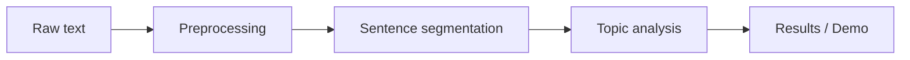

# NLP Sentence & Topic Analyzer

An NLP pipeline that splits raw text into sentences and analyzes it by topic, built as a lab project for my NLP course at VIT-AP University. A write-up of the work is included in this repository as a research paper.

[**Live Demo**](https://superior-red-bljyflbg.edgeone.dev/) · [**Research Paper**](paper/) · [Portfolio](https://ameerroshan.me/)

---

## Overview

Raw text is messy: abbreviations, inconsistent punctuation and mixed casing make even "split this into sentences" a non-trivial task. This project builds a small, readable pipeline that:

1. **Preprocesses** the input text (cleaning and normalization).
2. **Segments** it into individual sentences using language-aware handling.
3. **Analyzes** the sentences by topic, so a reader can see what a piece of text is about.

## Features

- Sentence segmentation with language-handling techniques for punctuation and abbreviations
- Text preprocessing (cleaning, normalization, tokenization)
- Topic-based text analysis over the segmented sentences
- Interactive web demo hosted online

## Pipeline



## Tech Stack

| Area | Tools |
|------|-------|
| Language | Python |
| Domain | Natural Language Processing, Text Processing |
| Demo | Hosted web demo (see link above) |

> TODO: add the exact libraries you used (for example NLTK, spaCy or scikit-learn) and the Python version.

## Research Paper

The accompanying research paper lives in the [`paper/`](paper/) folder.

> TODO: add the paper title, a one-line abstract, and the file name once uploaded.

## Getting Started

```bash
# 1. Clone the repository
git clone https://github.com/Rosh-am/nlp-sentence-topic-analyzer.git
cd nlp-sentence-topic-analyzer

# 2. (Optional) create a virtual environment
python -m venv venv
source venv/bin/activate        # Windows: venv\Scripts\activate

# 3. Install dependencies
pip install -r requirements.txt

# 4. Run
python main.py
```

> TODO: replace the file names and commands above with the ones in your project.

## Repository Structure

```
nlp-sentence-topic-analyzer/
├── paper/            # Research paper (PDF)
├── src/              # Source code
├── requirements.txt
└── README.md
```

> TODO: adjust to match your actual folders.

## Course Context

Developed as an NLP lab project at VIT-AP University, 2025.

## Author

**Ameer Roshan SK** · [GitHub](https://github.com/Rosh-am) · [LinkedIn](https://www.linkedin.com/in/ameer-roshan-sk/) · [Portfolio](https://ameerroshan.me/)
